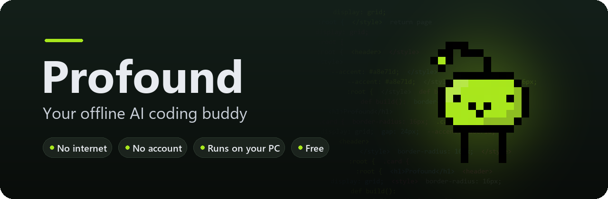
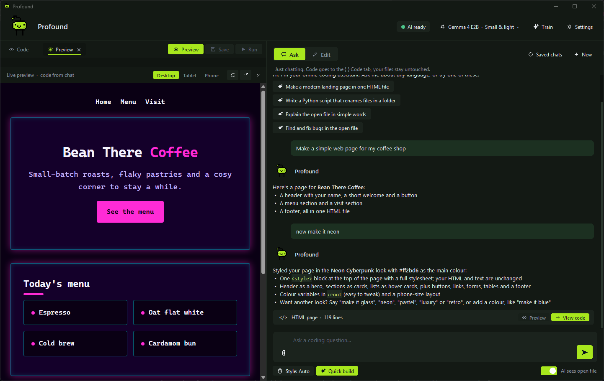
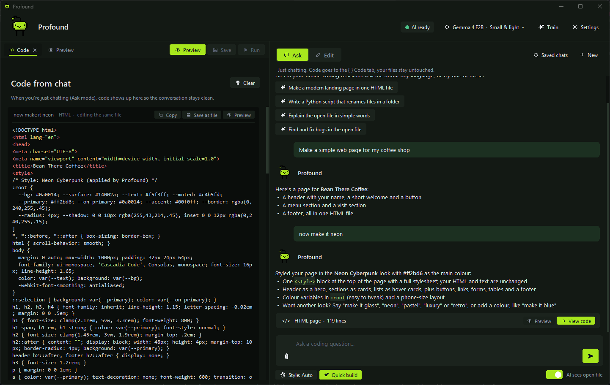
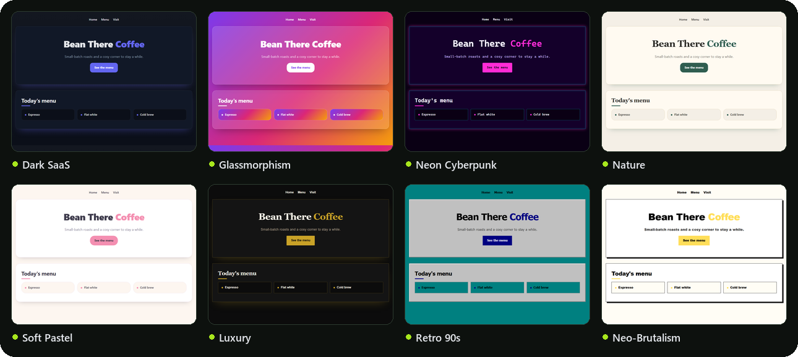

<p align="center">
  
</p>

<p align="center">
  <a href="https://github.com/yeeboein/profound/actions/workflows/build.yml"></a>
  
  
  
  
</p>

<p align="center">
  <b>Chat with an AI that writes, edits and styles your code, with no internet and no account.</b><br>
  Everything runs on your own computer, so your code never leaves it.
</p>

<p align="center">
  <a href="#-download">Download</a> ·
  <a href="#-features">Features</a> ·
  <a href="#-styles">Styles</a> ·
  <a href="#-get-a-model">Get a model</a> ·
  <a href="#-build-it-yourself">Build it yourself</a>
</p>

---

<p align="center">
  
</p>

## ✨ Features

<table>
<tr>
<td width="50%" valign="top">

### 💬 Ask or Edit
**Ask** mode just tells you the code. **Edit** mode works directly in the files of your open folder: you review, then save.

### 🧩 Live Code tab
Code appears in its own tab while the AI types, so the chat stays clean. Follow-ups such as "now style it" keep editing the same file.

### 👀 Live preview
Your web page in its own tab, updating as you type. It has Desktop, Tablet and Phone sizes and catches page errors.

### 🎨 Quick build and restyle
Even tiny models make great pages. Profound assembles them from 360+ hand-tuned CSS components and applies complete stylesheets in a second.

</td>
<td width="50%" valign="top">

### 🧠 Train it on your code
Feed Profound your own code and it follows your style. It ships with 380 HTML/CSS examples.

### ⚡ Best AI for your PC
It picks the smartest model your RAM can run, and the RAM Usage slider sets the limit. You can also bring your own `.gguf` models.

### 📎 Attach anything
Drag and drop images (the AI can see them), audio and any other files to use in your code.

### 🧰 And more
Saved chats, style presets, a VS Code / VSCodium extension, many languages, and a dark green theme.

</td>
</tr>
</table>

<p align="center">
  
</p>

## 🎨 Styles

Ask Profound to *"make it neon"*, *"make it glass"* or just *"now style it"*, and pick a look from the Style menu:

<p align="center">
  
</p>

## 📥 Download

Ready-made apps are on the **[Releases page](https://github.com/yeeboein/profound/releases)**. Each includes the AI engine:

| System | File |
|---|---|
| 🪟 Windows 10 / 11 | `Profound-Windows-x64.zip` |
| 🍎 Mac with Apple chip (M1 and newer) | `Profound-macOS-AppleSilicon.zip` |
| 🍎 Mac with Intel chip | `Profound-macOS-Intel.zip` |
| 🐧 Linux (Arch, Ubuntu...) | `Profound-Linux-x64.tar.gz` |

Unzip it, [add a model](#-get-a-model) to the `models` folder, and start Profound. Every version is built and
start-tested automatically on all four systems.

<details>
<summary><b>Mac and Linux notes</b></summary>

- **Mac:** the app isn't signed by Apple yet. The first time, open Terminal and run
  `xattr -dr com.apple.quarantine ~/Downloads/Profound` (use the folder where you unzipped it), then open `Profound.app`.
- **Linux:** needs Tk: `sudo pacman -S tk` (Arch) or `sudo apt install libtk8.6` (Ubuntu). Then run `./Profound`.
- On Mac and Linux the live preview opens in your web browser (it still updates as you type).

</details>

## 🤖 Get a model

Models are too big for GitHub, so download one or more `.gguf` files (search the name on Hugging Face) into `models/`:

| Model | File | RAM | Good for |
|---|---|---|---|
| **Gemma 4 12B** | `gemma-4-12B-it-Q4_0.gguf` (+ `mmproj-gemma-4-12B-it-Q8_0.gguf` to see images) | 16 GB | Best results |
| **Ministral 3 3B** | `Ministral-3-3B-Instruct-2512-Q4_K_M.gguf` | 4 GB+ | Small and smart |
| **Gemma 4 E2B** | `gemma-4-E2B-it-qat-UD-Q2_K_XL.gguf` | 4 GB | Low-RAM laptops |

## 🛠 Build it yourself

<details>
<summary><b>Run from source</b></summary>

Download a [llama.cpp release](https://github.com/ggml-org/llama.cpp/releases) for your system and extract it
so `llama-server` sits in an `engine/` folder next to `profound_app.py`. Then:

```powershell
python profound_app.py
```

On Linux and macOS, see [README_LINUX_MAC.md](README_LINUX_MAC.md) (`run_linux.sh`, `run_macos.sh`).

</details>

<details>
<summary><b>Build the Windows app</b></summary>

```powershell
pip install pyinstaller
.\build.ps1
```

This creates `Profound-App\Profound.exe` with `engine\` next to it. Put your models in `Profound-App\models\`.
On Linux or macOS, run `./build_unix.sh` on that machine.

</details>

<details>
<summary><b>Project layout</b></summary>

| File | What it does |
|---|---|
| `profound_app.py` | The whole app: UI, chat, editor, preview, training, engine control |
| `page_builder.py` | Quick build page assembler |
| `restyle.py` | Complete stylesheets applied to existing pages |
| `make_css_pack.py` | Generates the CSS components and templates in `training_pack/` |
| `vscode_ext/` | VS Code / VSCodium extension |
| `.github/workflows/build.yml` | Builds and tests the apps for every system |

</details>

---

<p align="center">
  <br>
  <sub>Made by <a href="https://github.com/yeeboein">yeeboein</a></sub>
</p>
